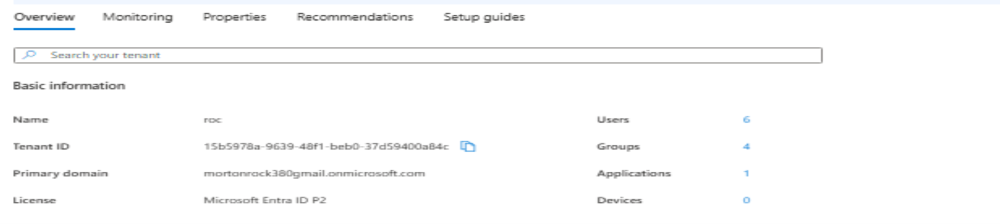
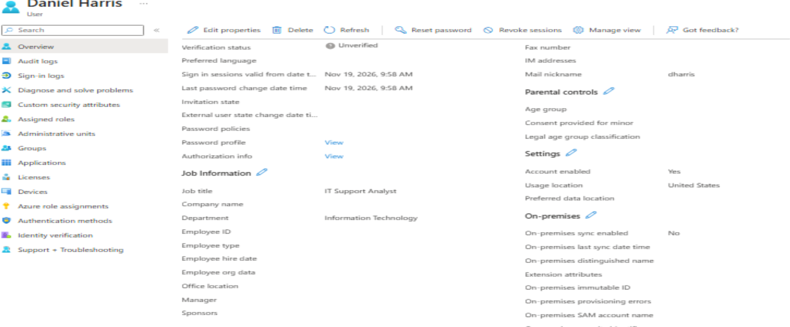
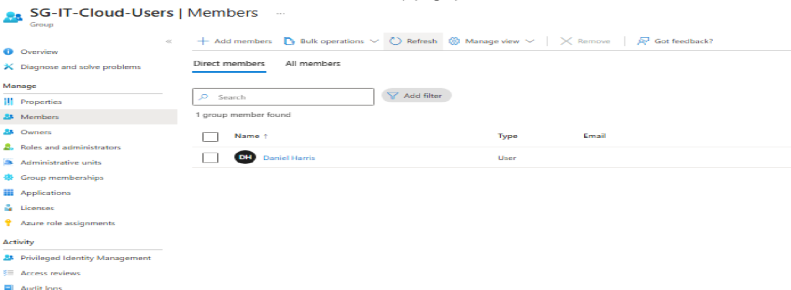
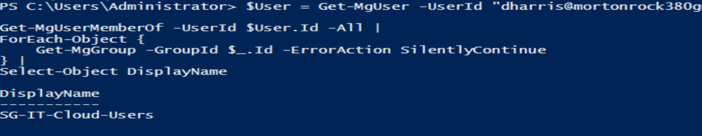
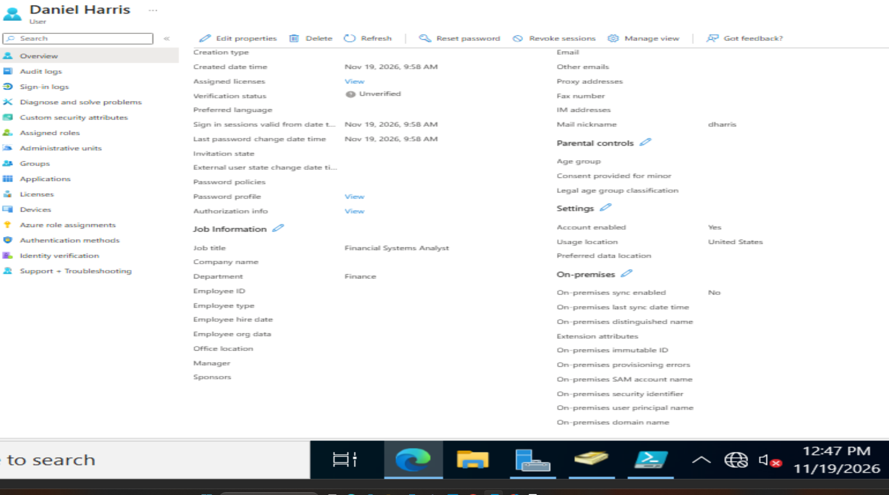
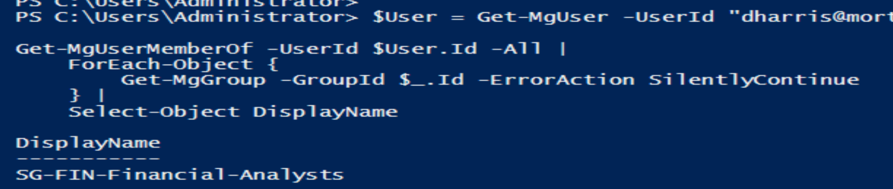
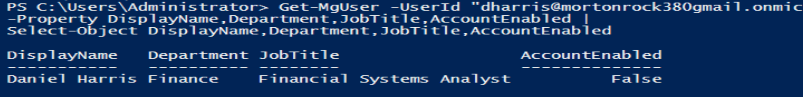
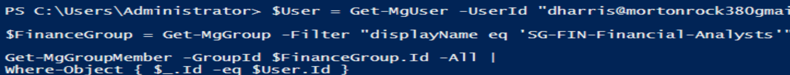

# Microsoft Entra ID — Cloud Identity Lifecycle Management

Hands-on **cloud-only Identity and Access Management (IAM)** lab demonstrating Joiner–Mover–Leaver (JML) operations in Microsoft Entra ID, with portal evidence and Microsoft Graph PowerShell validation.

## Lab overview

- **Platform:** Microsoft Entra ID (tenant reported as P2)
- **Identity type:** Cloud-only; no Microsoft Entra Connect Sync configured
- **Test identity:** Daniel Harris (`dharris`), fictional lab employee
- **Access model:** Assigned cloud security-group memberships
- **Authorization:** Simulated IAM tickets and approvals; no real business owner approvals
- **Verification:** Entra admin center and Microsoft Graph PowerShell

## Case studies

| Scenario | Change | Observed verification |
| --- | --- | --- |
| [IAM-ENTRA-001 — Joiner](docs/IAM-ENTRA-001-joiner.md) | Provision Daniel as IT Support Analyst; add `SG-IT-Cloud-Users` | Enabled account, IT attributes, IT group returned |
| [IAM-ENTRA-002 — Mover](docs/IAM-ENTRA-002-mover.md) | Transfer to Finance; remove IT membership; add `SG-FIN-Financial-Analysts` | Enabled account, Finance attributes, Finance group returned; IT group not returned |
| [IAM-ENTRA-003 — Leaver](docs/IAM-ENTRA-003-leaver.md) | Disable account; remove Finance group membership | `AccountEnabled=False`; Finance group member query returned no match |

## Repository contents

- [Joiner case study](docs/IAM-ENTRA-001-joiner.md)
- [Mover case study](docs/IAM-ENTRA-002-mover.md)
- [Leaver case study](docs/IAM-ENTRA-003-leaver.md)
- [PowerShell authentication troubleshooting](docs/troubleshooting.md)
- [Read-only validation commands](scripts/validation-commands.ps1)
- [Screenshot inventory and upload guide](screenshots/README.md)

## Security and evidence boundaries

This project validates **directory account attributes and group membership**, not actual application/resource authorization, interactive sign-in, MFA enforcement, token/session revocation, or complete offboarding across connected services. Group names alone do not prove access to resources. An empty group membership query is meaningful only when the query completed without error and resolved the intended group. Lab approvals and tickets are simulated. Screenshots are uploaded separately and must be reviewed for secrets and personal identifiers before publication.

## Next learning areas

MFA and Conditional Access testing, cloud role governance, and access reviews where tenant licensing, consent, and permissions allow. Hybrid identity synchronization is a future phase, **not implemented in this project**.

---
**Portfolio:** [Joiner–Mover–Leaver (on-prem AD)](https://github.com/Cooltechcyber/iam-joiner-mover-leaver) · [User Access Review (on-prem AD)](https://github.com/Cooltechcyber/iam-user-access-review)

## Screenshot evidence

**01-entra-tenant-overview.png**

**04-entra-daniel-harris-created.png**

**05-entra-daniel-it-group-membership.png**

**07-entra-graph-group-verification.png**

**10-entra-daniel-finance-properties.png**

**14-entra-mover-graph-group-verification.png**

**17-entra-leaver-graph-account-verification.png**

**18-entra-leaver-graph-group-verification.png**

