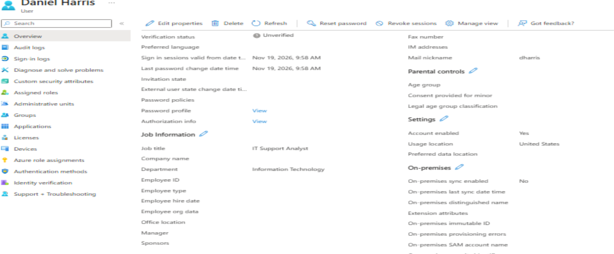
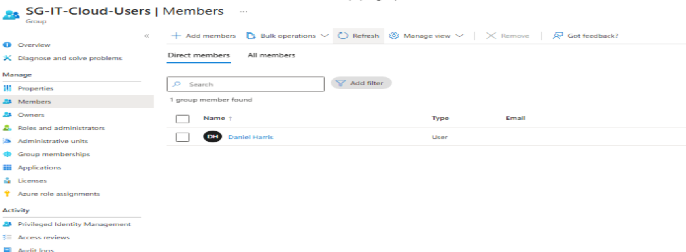
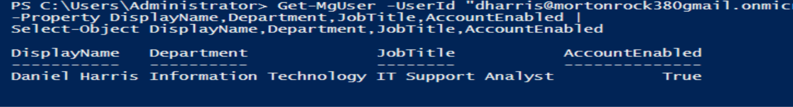
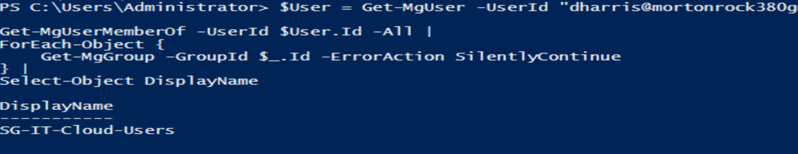

# IAM-ENTRA-001 — Cloud Joiner Provisioning

**Scenario:** A fictional new hire, Daniel Harris, joins Information Technology as an IT Support Analyst. **Approval:** Simulated lab ticket, not a real manager approval.

## Scope and change

1. Inspected the Entra tenant and existing cloud-only user/group inventory.
2. Created `dharris@mortonrock380gmail.onmicrosoft.com` as a cloud-only member.
3. Set department **Information Technology**, job title **IT Support Analyst**, usage location **United States**, and enabled the account.
4. Created assigned security group `SG-IT-Cloud-Users` and added Daniel as a direct member.
5. Validated the account and group membership with Microsoft Graph PowerShell.

## Observed validation

```text
DisplayName   Department             JobTitle           AccountEnabled
Daniel Harris Information Technology IT Support Analyst True

DisplayName
SG-IT-Cloud-Users
```

**Result:** PASS — cloud identity attributes and IT group membership were confirmed. Successful sign-in, MFA, application access, and resource permissions were not tested.

## Evidence checklist

- `04-entra-daniel-harris-created.png`
- `05-entra-daniel-it-group-membership.png`
- `06-entra-graph-user-verification.png`
- `07-entra-graph-group-verification.png`

See [validation commands](../scripts/validation-commands.ps1) and [screenshot guide](../screenshots/README.md).

## Screenshot evidence

**04-entra-daniel-harris-created.png**



**05-entra-daniel-it-group-membership.png**



**06-entra-graph-user-verification.png**



**07-entra-graph-group-verification.png**


